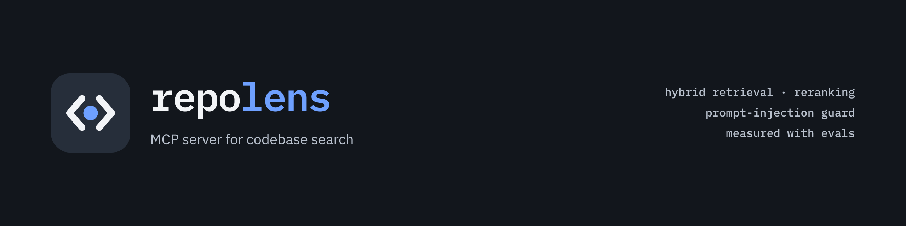

<p align="center">
  
</p>

# repoLens

An MCP server for codebase exploration. It indexes a local Git repository, answers
code-search questions with hybrid retrieval (BM25 + dense vectors) and reranking,
flags prompt injection hidden in repository content, and ships with an evaluation
harness that measures retrieval quality with real numbers.

> **Status: v0.1 in progress.** Indexing, search and the eval harness work today.
> Still to come: the MCP server (`repolens serve`), the prompt-injection guard,
> request tracing and Docker. This README will get its final form with them.

## Quickstart

```bash
uv sync

# Build an index (Python files; respects .gitignore)
uv run repolens index path/to/repo --out .repolens/myrepo

# Search it
uv run repolens query .repolens/myrepo "where are HTTP retries configured?"
uv run repolens query .repolens/myrepo "Client.send" --mode bm25 --k 3
```

Models are downloaded from Hugging Face on first use and then cached. Everything
runs locally; the optional LLM-judge reranker is the only component that can call
a remote endpoint, and only when you configure one.

## How it works

1. **Chunking:** tree-sitter splits Python files into functions, methods, class
   headers and module-level code, each with a qualified name (`Client.send`).
2. **Retrieval:** BM25 over code-aware tokens (`HTTPClientError` → `http client
   error`) and dense search (FAISS HNSW over `BAAI/bge-small-en-v1.5` embeddings),
   fused with Reciprocal Rank Fusion.
3. **Reranking (optional, off by default):** an LLM judge on any OpenAI-compatible
   endpoint (vLLM, Ollama, …), or a local cross-encoder.

Search modes: `dense` (default), `hybrid`, `bm25`. The defaults follow the
[evaluation](#evaluation): dense retrieval without reranking is the best *fast*
configuration. Configuration lives in `repolens.toml` (see
[`repolens.example.toml`](repolens.example.toml)) or in `REPOLENS_*` environment variables.

### Quality mode: LLM judge

If you have an OpenAI-compatible model server, hybrid retrieval plus the LLM judge
ranks much better (MRR@10 0.894 vs 0.733 on the benchmark), at the cost of one LLM
call per query: ~36 s with a local Qwen model on a DGX Spark. It is opt-in, because it sends
the retrieved code to that endpoint:

```toml
# repolens.toml
[retrieval]
default_mode = "hybrid"

[rerank]
backend = "llm_judge"
top_n = 30                       # candidates the judge scores per query

[rerank.llm_judge]
base_url = "http://localhost:8000/v1"
model = "your-model-id"
timeout_s = 180
# api_key: set REPOLENS_RERANK__LLM_JUDGE__API_KEY instead of writing it here
```

Use `--no-rerank` to skip the judge for a single query.

## Evaluation

`repolens eval` runs a hand-written benchmark against a pinned repository and
reports Recall@k, MRR@10, nDCG@10 and latency per pipeline configuration.
The current seed set has 30 questions on [httpx](https://github.com/encode/httpx)
0.28.1: exact symbol lookups, conceptual "where/how" questions and cross-file questions.

| Config | Recall@1 | Recall@5 | Recall@10 | MRR@10 | nDCG@10 | Mean ms | p95 ms |
|---|---:|---:|---:|---:|---:|---:|---:|
| bm25 | 0.406 | 0.617 | 0.689 | 0.564 | 0.555 | 0.1 | 0.1 |
| dense | 0.556 | 0.700 | 0.828 | 0.733 | 0.721 | 6.7 | 7.2 |
| hybrid | 0.539 | 0.739 | 0.756 | 0.721 | 0.687 | 6.8 | 7.2 |
| hybrid + cross-encoder | 0.378 | 0.622 | 0.756 | 0.540 | 0.576 | 855.1 | 968.6 |
| hybrid + LLM judge | **0.667** | **0.889** | **0.906** | **0.894** | **0.865** | 36,439 | 39,527 |

Produced by `repolens eval`. Retrieval and the cross-encoder ran on CPU. The LLM judge
was `qwen3.8-flash-next-chat` on a local OpenAI-compatible server (DGX Spark),
reranking the top 30 hybrid candidates in one call per query (~5.2k prompt tokens).
Full report: [`evals/results/20261012T142533Z.json`](evals/results/20261012T142533Z.json).
What these numbers say, honestly:

* **The LLM judge is by far the best ranker** (MRR@10 0.894 vs 0.733 for dense),
  especially on conceptual and cross-file questions. It is also ~36 s per query on
  this hardware, so it suits offline or batch use, not interactive search.
* **Dense retrieval is the best fast configuration.** Fusing in BM25 helps
  Recall@5 but hurts cross-file questions.
* **The default cross-encoder (`ms-marco-MiniLM-L-6-v2`) makes ranking worse** and
  costs ~0.9 s per query on CPU. It was trained on web passages, not code.
* With 30 questions, differences below ~0.05 are within noise.

Reproduce, or add questions: see [`evals/CONTRIBUTING.md`](evals/CONTRIBUTING.md).

```bash
git clone https://github.com/encode/httpx evals/repos/httpx
git -C evals/repos/httpx checkout 26d48e0634e6ee9cdc0533996db289ce4b430177
uv run repolens index evals/repos/httpx --out .repolens/httpx
uv run repolens eval --index .repolens/httpx --dataset evals/datasets/httpx.jsonl
```

## Development

```bash
uv sync
uv run ruff check && uv run ruff format --check
uv run mypy
uv run pytest -m "not slow"   # fast suite: no model downloads
uv run pytest -m slow         # real embedding / reranker models
```

## License

[MIT](LICENSE)
